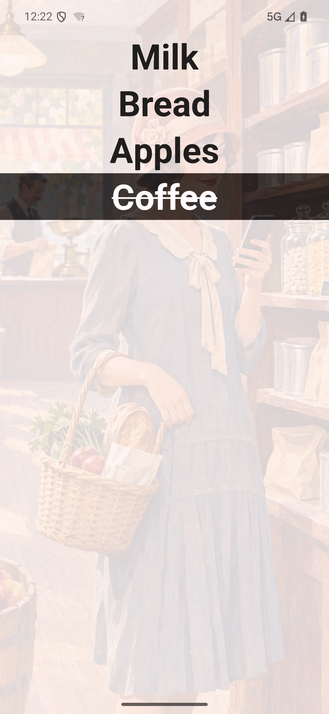
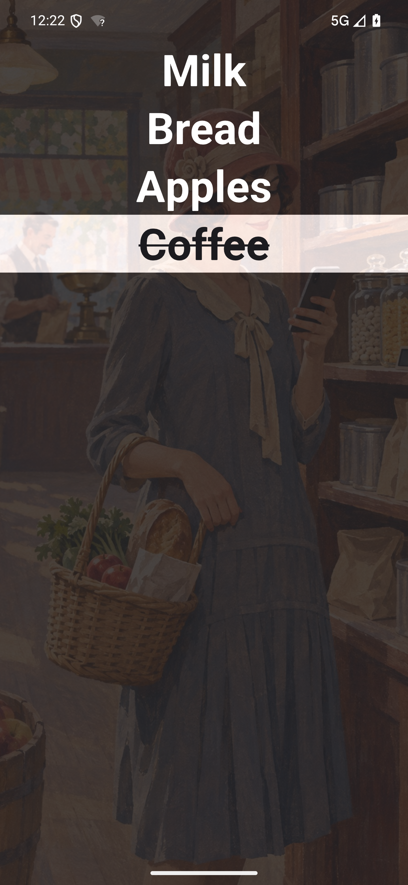

# QShopper

A shopping list for one-handed use in the shop. Built with Qt Quick and C++20,
primarily for Android.

  
  

- Swipe to check items; swipe right in edit mode to delete. Undo restores the
  latest deletion action, with 15 seconds to recover each earlier action.
- Move the editor to the right place in your shopping route. Return keeps the
  keyboard open; voice entry comes from your Android keyboard.
- Checked items form a stack for nearby correction. Reset restores their
  collection order, after any unchecked items.
- Keep several lists and choose Light, Dark or System with vivid theme colors.
- Large text adapts to long names; touch targets use a 9.27 mm reference row.

Lists/settings are local. Android backup and keyboard services have their own
settings; see the [privacy policy](https://samuelnevala.github.io/QShop/privacy-policy.html).

## Build and run

Install Qt **6.12+**, a **C++20** compiler and **CMake 3.25+**. Open
`CMakeLists.txt` in Qt Creator, select a desktop or Android kit, then Build/Run.
[BUILDING.md](BUILDING.md) covers installation and command-line builds;
[ANDROID.md](ANDROID.md) covers APKs and devices.

## Status and branches

Near feature complete; production signing and Google Play publication are in
preparation. See [BACKLOG.md](BACKLOG.md) and [RELEASE.md](RELEASE.md).

`master` is Qt 6; `qt6/qshopper` is the development branch. The independent
`qt5/qshopper` history preserves the old Qt 5 app and its LGPL licence. Use a fresh
clone when moving from the old history.

## Versions

Current candidate: **v0.1.0-rc.1 / Android code 6**. The app version name remains
**0.1.0**; root CMake owns the app version and Android code.
Before 1.0, bump PATCH for fixes and MINOR for features. Increase Android code for
each shared update; keep its signing identity. Tag accepted releases, not local
rebuilds, and record the tested commit.

## Contributing

Keep changes simple and focused. Read [DESIGN.md](DESIGN.md) and
[CODING_GUIDELINES.md](CODING_GUIDELINES.md). Bug fixes need failing-before and
passing-after regression coverage; [tests/README.md](tests/README.md) explains
the checks. Report issues on [GitHub](https://github.com/SamuelNevala/QShop/issues).

## Licence

Copyright 2014–2026 Samuel Nevala. Project code is **GPL-3.0-or-later**;
third-party assets/components retain their own terms. See [LICENSE](LICENSE),
[LICENSING.md](LICENSING.md) and [source distribution](SOURCE_DISTRIBUTION.md).
Charging for the official build does not remove recipients' GPL rights.
