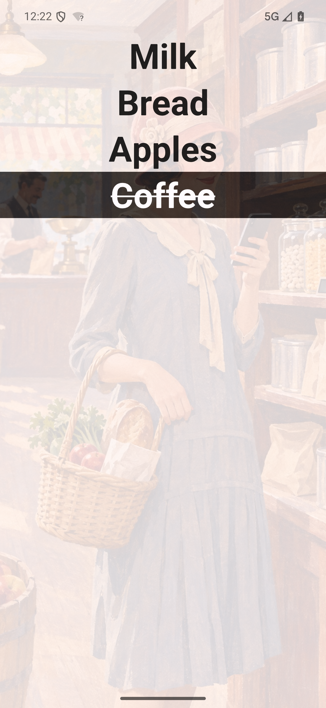
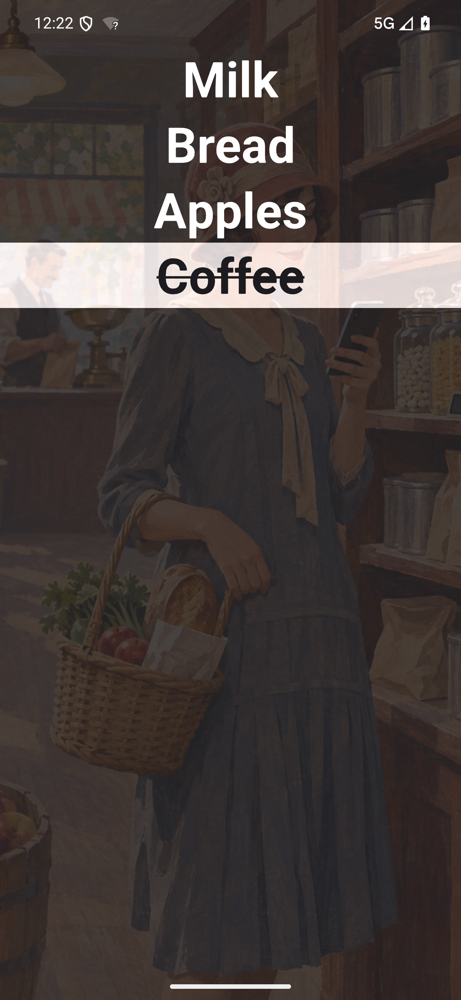

# QShopper

A shopping list for one-handed use in the shop. Built with Qt 6, Qt Quick and
C++20, with Android as the main target and a Windows development build.

Write items as they come to mind, place them in your shopping order, and check
them with deliberate horizontal swipes. The list stays under your control.

<p>
  
  
</p>

## In the shop

- Swipe to check or uncheck an item. In edit mode, swipe right to delete it.
- Checked items form a stack: the latest checked item stays closest to the
  unchecked part of the list, making a mistake easy to correct.
- Move the editor to the place where the next item belongs. Keep typing or use
  your Android keyboard's dictation; Return submits without closing the keyboard.
- Undo one deletion action at a time. Each earlier action exposed by Undo gets
  a fresh 15-second recovery window.
- Reset checks to recover the order in which items were collected, while leaving
  existing unchecked items first.
- Keep separate lists and choose Light, Dark or System theme with your own
  primary and accent colors.

Touch geometry uses a 9.27 mm reference row. Item text starts large, then shrinks
and wraps for longer entries. Background illustrations and animated transitions
are part of the design. See [DESIGN.md](DESIGN.md) for the reasoning behind these
choices.

## Project status and branches

The Qt 6 application is near feature complete and under active testing. This is
a development project; store publication and release signing are still being
prepared. Current work and validation gaps are recorded in [BACKLOG.md](BACKLOG.md).

| Branch | Purpose |
| --- | --- |
| `master` | Current Qt 6 application |
| `qt6/qshopper` | Qt 6 development branch |
| `qt5/qshopper` | Archived Qt 5 version, retaining its original license and files |

The Qt 5 and Qt 6 histories remain separate. The legacy branch is provided for
reference; current development targets Qt 6.
For an existing Qt 5 clone, keep local work on the legacy history; a fresh clone
is the simplest way to start with Qt 6.

## Versions

The current development version is **0.1.0**. Before the first public release,
use `0.MINOR.PATCH`: increase PATCH for fixes and MINOR for features or deliberate
behavior changes. Reserve `1.0.0` for the first stable public release.

The root `CMakeLists.txt` owns both `project(... VERSION ...)` and
`QSHOPPER_ANDROID_VERSION_CODE` (currently **4**). The project version becomes
the runtime application version and Android `versionName`. Increase the Android
code for every shared update build, even if its display version stays the same;
local rebuilds may reuse it. ARM64 and emulator builds of the same revision use
the same code. Keep the signing key unchanged when updating an existing install.

For an accepted release, record its changes and tag the exact tested commit
`v0.1.0` (and similarly for later versions). A version bump alone does not publish
a release. Include the source revision in bug reports about development builds.

## Build and run

Requirements:

- Qt **6.12 or newer**, including Core, Qml, Quick, QuickControls2 and Sql.
- A **C++20** compiler, **CMake 3.25+** and Ninja.
- Qt Virtual Keyboard for the default desktop Debug build. Android uses its
  native keyboard and does not bundle this module.

The validated Windows kit is Qt 6.12.0 with MSVC 2022 x64. Qt Creator is optional.

```powershell
git clone https://github.com/SamuelNevala/QShop.git
cd QShop
./tools/verify-windows.ps1 -Action Build -QtRoot C:/Qt/6.12.0/msvc2022_64
./out/windows-agent/application.exe
```

The helper initializes the Visual Studio x64 environment and uses the installed
Qt/CMake/Ninja tools. Its `-QtRoot`, `-CMakeBin` and `-Ninja` options support other
installation paths. Set the CMake option `QSHOPPER_DESKTOP_KEYBOARD=OFF` to build
without the desktop keyboard; `AUTO` enables it for desktop Debug builds.

For an ARM64 Android debug APK, install the Android Qt kit, SDK/NDK and JDK, then:

```powershell
./build-android.ps1 -Architecture arm64
```

The APK is written to `dist/QShopper-arm64-debug.apk`. Build setup, emulator
instructions and matching the signing key of an existing installation are in
[ANDROID.md](ANDROID.md). Android 9/API 28 is the current minimum. Phone use is
portrait-oriented; Android's large-screen overrides are documented there.

Debug APKs are development artifacts. Production signing and store publication
are separate release tasks.
The [release guide](RELEASE.md) covers personal Play Console registration,
signing/update planning, size-optimized APK/AAB builds and the testing path to
publication.

## Tests and contributions

After building on Windows, run the model, QML, keyboard and rendering suites:

```powershell
./tools/verify-windows.ps1 -Action Test
```

[tests/README.md](tests/README.md) documents focused tests, native Android
regressions, formatting and static analysis. Automated app launches use isolated
data. Desktop tests complement native IME, gesture and rendering checks; physical
one-handed use remains part of acceptance.

Keep contributions focused and simple. Follow [CODING_GUIDELINES.md](CODING_GUIDELINES.md)
and the existing formatter configurations. A bug fix needs a regression test
that fails before the fix and passes afterward. For reports or proposed changes,
use [GitHub issues](https://github.com/SamuelNevala/QShop/issues).

## Data and keyboard

Lists and settings are stored locally using SQLite and Qt settings. QShopper has
no account or cloud-sync service. Dictation is supplied by the selected Android
keyboard, whose own permissions and privacy settings apply.

## License

QShopper project code, tooling and documentation are licensed under
**GPL-3.0-or-later**. See [LICENSE](LICENSE) and [COPYRIGHT](COPYRIGHT).

Qt, Font Awesome and other third-party material retain their own licenses and
notices. The app's About view provides offline dependency notices;
[LICENSING.md](LICENSING.md) explains the source and asset licensing. Background
illustrations were generated for the project; their provenance is recorded in
[artwork/UI-013](artwork/UI-013/README.md).
